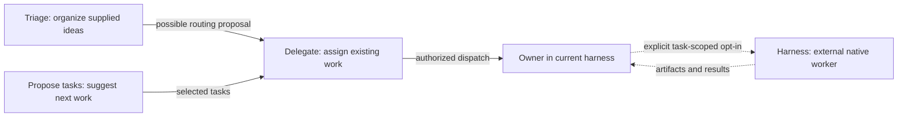

# Coordination skills

Five independently usable capabilities for organizing ideas, proposing work, assigning tasks, operating an external native worker, and holding requested review checkpoints. There is no required sequence. Their source folders live together here, following the project-management package layout. Installed skill names remain unchanged.

## Choose the starting point

| Skill | Use it when | Result |
| --- | --- | --- |
| [triage](triage/SKILL.md) | A brain dump or mixed conversation needs working through. | Complete topics, useful answers, preserved intent, and possible continuations. No automatic dispatch, including inquiry/preparation handoffs. |
| [propose-tasks](propose-tasks/SKILL.md) | The question is what to do next in a project or established thread. | Existing plans checked first; remaining commitments distinguished from optional further development in a numbered task/justification table. |
| [delegate](delegate/SKILL.md) | Tasks already exist and need owners or a delegation proposal. | Concrete recipient/model recommendations, authorized dispatch within the current harness, and checked results. Existing chats are preferred where useful. |
| [harness](harness/SKILL.md) | The human explicitly chooses another harness for defined work. | Agreed native client/subscription/model/effort, recoverable execution, failure handling, and artifacts returned to the owner. |
| [pause-for-review](pause-for-review/SKILL.md) | The human explicitly requests staged review checkpoints. | Prepared artifacts, an explicit review hold, and continuation according to the human’s instructions. |

Triage draws structure from supplied material. Propose-tasks draws useful options from current project or thread state. Both can end in discussion without assigning anything. When inspected agreed work is complete, propose-tasks says so; required decisions, blockers, and held integration remain open.

Pause-for-review can add explicitly requested checkpoints anywhere in these workflows. It remains independently invoked; collection membership does not add review gates or activate it automatically. The other skill entrypoints need no behavior changes for this move.

## How the skills connect



These are capability boundaries, not mandatory approval rounds. Existing sufficient human authorization carries forward. Triage may consult delegate in proposal-only mode; loading either skill, selecting a topic, or installing the package does not authorize messaging or new chats. Task selection preserves the original IDs and proposal identity. Related tasks can share one owner.

Delegate prepares an assignment proposal by default; explicit execution or approval of a concrete assignment enables dispatch. It preserves existing task IDs and gives unnumbered source items proposal IDs. Delegate chooses the owner. Harness operates an external worker for that owner, which retains acceptance and final reporting. Without explicit opt-in, stay internal and skip external subscription/route inspection. Opt-in supplied upstream travels with the task and its holds. An authorized handoff also supplies the destination host's explicit skill invocation; permission text alone does not activate an explicit-only skill. The [invocation reference](delegate/references/skill-invocation.md) records the supported forms and verification limits. Harness also works directly in an owner chat.

When relevant harness/subscription/model/usage-distribution guidance is missing, harness asks a targeted question with a provisional recommended model/route and reason **before** an external assignment enters the delegation proposal. Adequate existing preferences need no repeated question.

Each proposed handoff identifies its owner model and supported effort; the worker's model, effort, client, and subscription are separate choices. Use explicit supported controls rather than an unknown destination picker. Request, acceptance, and observed runtime identity are distinct. The [model-control note](delegate/references/model-control.md) records current Codex tools and verification limits. Manual selection is needed only for settings the actual route cannot control.

Decisions use the requested outcome, correctness, context/tools, delivery time, human attention, and coordination effort. Financial optimization and savings estimates are excluded. Explicit spending boundaries remain in force.

## Shared message and greeting rules

The [chat-source rule](../../../rules/chat-source/RULE.md) stays always-on and outside the skills package. It covers agent requests even when delegate was not used: a small origin/source marker, a brief plain-language request, useful headings for long briefs, and an initial/final reply that identifies the requesting agent/chat and explains the task and result. Short follow-ups need not repeat a form. Native metadata can satisfy provenance; a label grants no authority.

The [address-the-user rule](../../../rules/address-the-user/RULE.md) keeps the human’s name preference and addresses the agent as “boss” when replying directly to an agent-originated message. This general rule owns personal addressing; the skills do not. Project prose remains role-neutral.

## Install

```bash
./scripts/install.sh --skills --package coordination --cursor --claude --agents
```

This installs all five skills and their resources while preserving other installed skills. Individual runtime use remains independent; the package installer includes all five members. Shared message and greeting rules use the normal rule installation flow; `--rules` refreshes all registered rules.

## Evidence and maintenance

Harness uses conditional native adapters; historical evidence stays in [repository review records](../../../docs/audits/evidence/coordination-native-runs/README.md) and is excluded from installed skill resources. These establish observed mechanics, not behavioral improvement or permanent model/subscription eligibility. Direct work in the current chat remains the simple baseline. Reconsider steps that add friction without improving correctness, recovery, or human understanding, and recheck adapters when tools change.

The [promotion and installation closeout](../../../docs/audits/2026-10-26-coordination-package.md) records approved review changes, checks, and remaining verification limits.
